# Mall Customer Segmentation — K-Means · Agglomerative Hierarchical · DBSCAN

**Red & White Skill Education · Unsupervised Learning · PR 1**

Customer segmentation of a shopping-mall dataset using three unsupervised clustering algorithms, with a side-by-side comparison and business recommendations.

## Dataset
- **Mall Customer Segmentation Data** (Kaggle, CC0): https://www.kaggle.com/datasets/vjchoudhary7/customer-segmentation-tutorial-in-python
- 200 customers; features: `Gender`, `Age`, `Annual Income (k$)`, `Spending Score (1-100)` (`CustomerID` dropped). No missing values or duplicates.

## Video
🎥 **Video explanation:** `PASTE_YOUR_GOOGLE_DRIVE_OR_YOUTUBE_LINK_HERE`

## Repository contents
| File | Description |
|---|---|
| `UL_PR1.ipynb` | Full notebook (all 7 tasks, executed top to bottom) |
| `UL_PR1.html` | HTML export of the notebook |
| `Mall_Customers.csv` | Dataset |
| `screenshots/` | Key plots (listed below) |
| `requirements.txt` | Python dependencies (pinned) |

## Workflow
1. **EDA** — histograms + KDE, pairplot, correlation heatmap. Income vs Spending Score shows ~5 natural groups.
2. **Preprocessing** — rename columns, drop `CustomerID`, encode Gender (Female=0, Male=1), `StandardScaler` on Age / Income / Spending Score; 2-feature subset `df_2f` for clustering.
3. **Algorithms** (below), then a comparison with Silhouette, Davies-Bouldin and Calinski-Harabasz metrics, and a business insight report.

## Algorithms
### 1. K-Means
Centroid-based; assigns each point to the nearest of *k* centroids and minimises within-cluster sum of squares (inertia). *k* chosen with the Elbow method and Silhouette score — both give **k = 5**.

### 2. Agglomerative Hierarchical Clustering (Ward linkage)
Bottom-up: repeatedly merges the two clusters that least increase total within-cluster variance. A dendrogram is cut at the longest vertical gap → **5 clusters**.

### 3. DBSCAN
Density-based; groups points that have at least `min_samples` neighbours within radius `eps`, labels sparse points as noise (−1). `eps` estimated from a 4-NN distance plot and a grid search → **eps = 0.4, min_samples = 5** (4 clusters, 15 noise points).

## Results
| Algorithm | Clusters | Silhouette | Davies-Bouldin ↓ | Calinski-Harabasz |
|---|---|---|---|---|
| K-Means | 5 | 0.555 | 0.572 | 248.6 |
| Hierarchical (Ward) | 5 | 0.554 | 0.578 | 244.4 |
| DBSCAN (noise excluded) | 4 (+15 noise) | 0.478 | 0.591 | 146.9 |

**Recommended for deployment: K-Means** — best metrics, every customer assigned, and the most interpretable segments.

### Customer segments (K-Means)
| Segment | Marketing action |
|---|---|
| High Income, High Spenders | Loyalty / VIP programme |
| Low Income, High Spenders | Budget promotions, instalment offers |
| Mid Income, Mid Spenders | Bundles and cross-selling |
| High Income, Low Spenders | Personalised premium outreach |
| Low Income, Low Spenders | Low-cost value communication |

## Screenshots
| Plot | Caption |
|---|---|
| 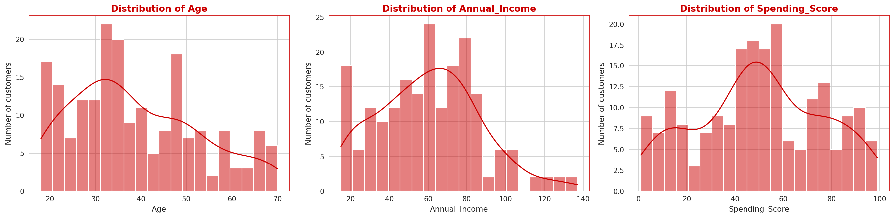 | Histograms with KDE for Age, Annual Income and Spending Score |
| 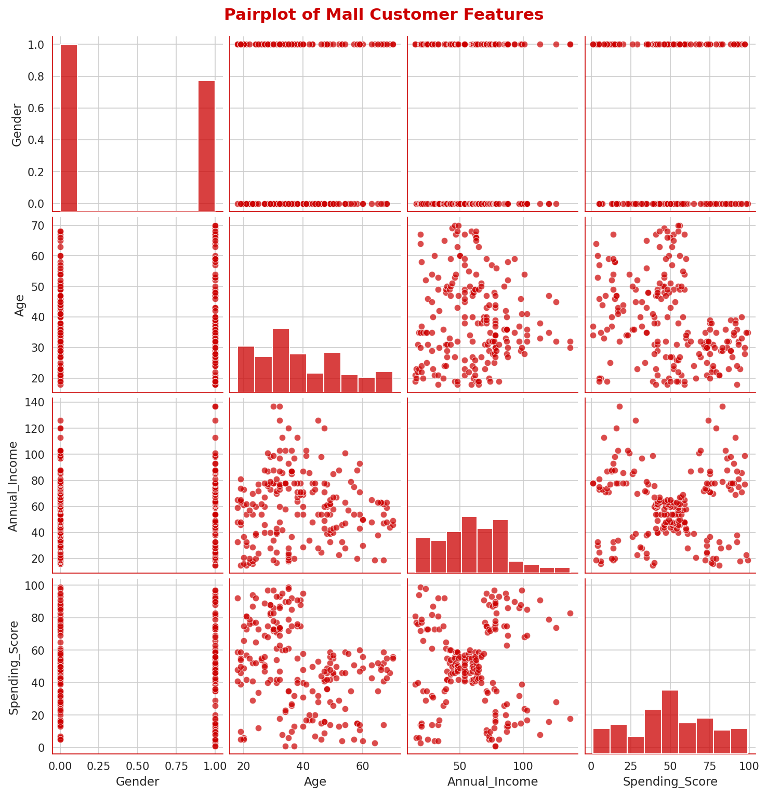 | Pairplot — Income vs Spending Score shows ~5 groups |
| 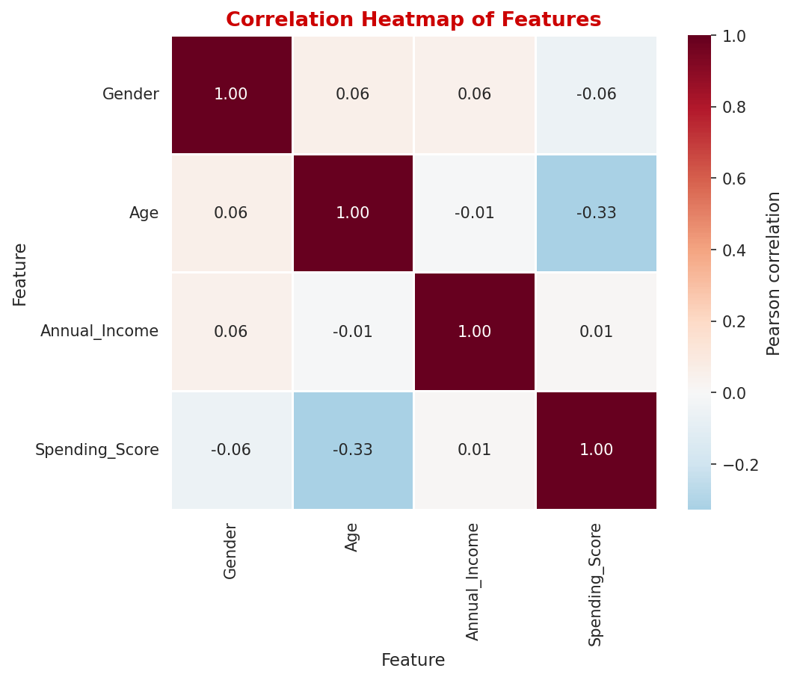 | Correlation heatmap — weak linear correlations |
| 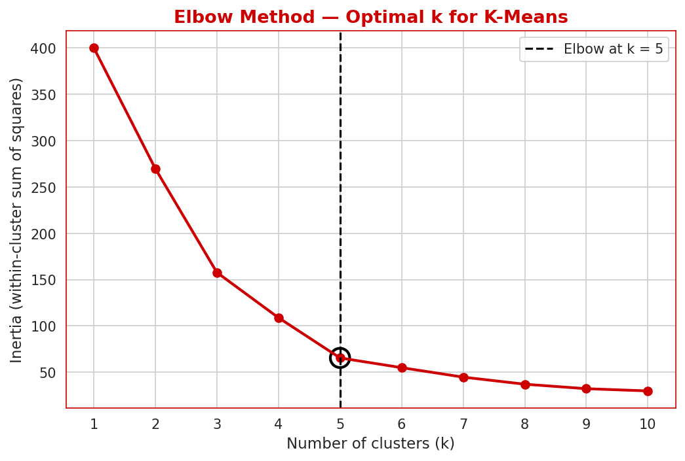 | Elbow method — elbow at k = 5 |
| 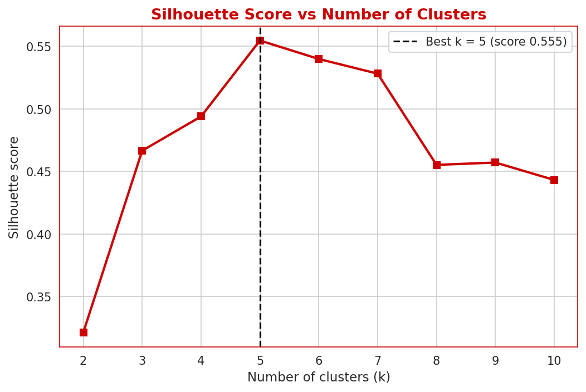 | Silhouette scores — best at k = 5 |
| 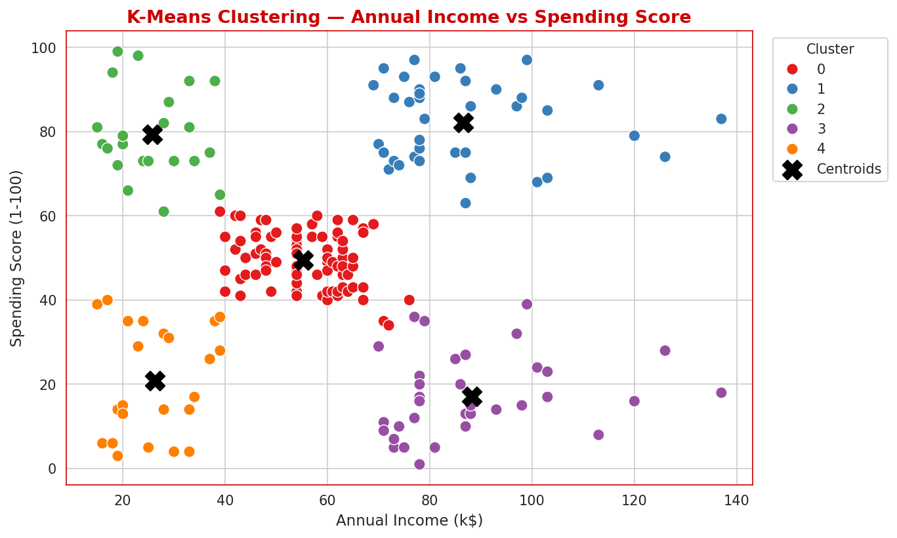 | K-Means clusters with centroids (black X) |
| 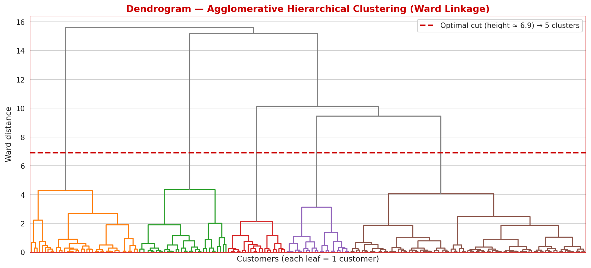 | Ward dendrogram with cut line |
| 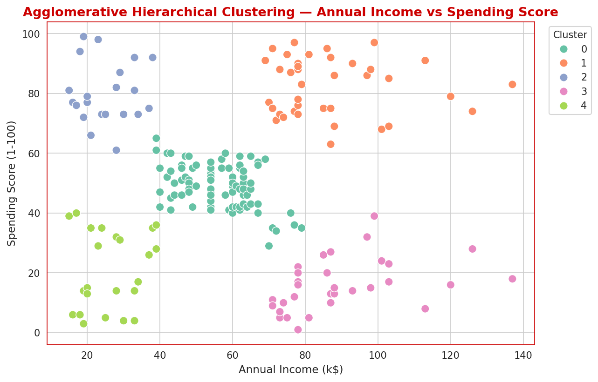 | Hierarchical clusters |
| 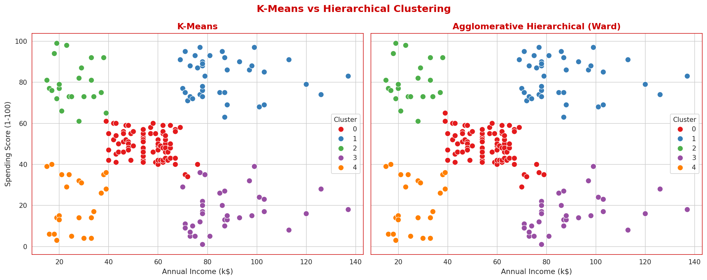 | K-Means vs Hierarchical |
| 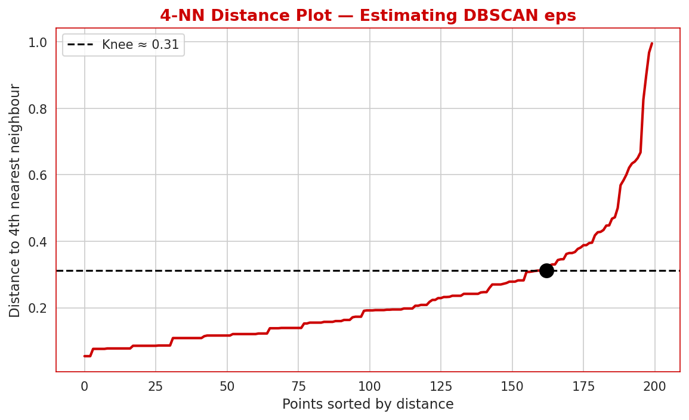 | 4-NN distance plot for DBSCAN eps |
| 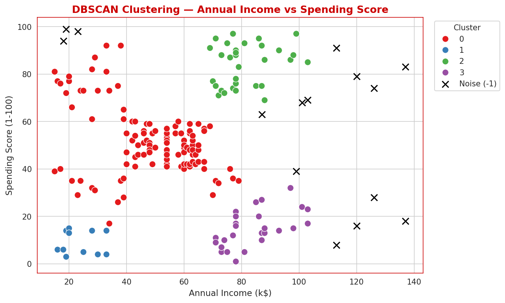 | DBSCAN clusters (noise = black x) |
| 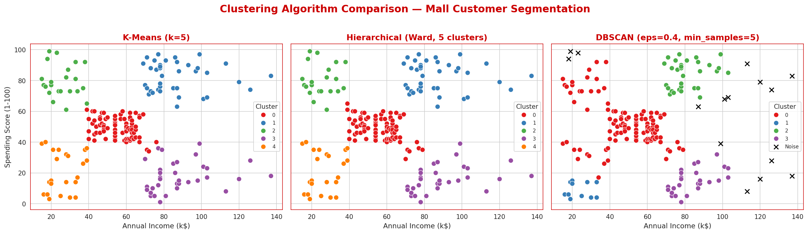 | Three-panel algorithm comparison |
| 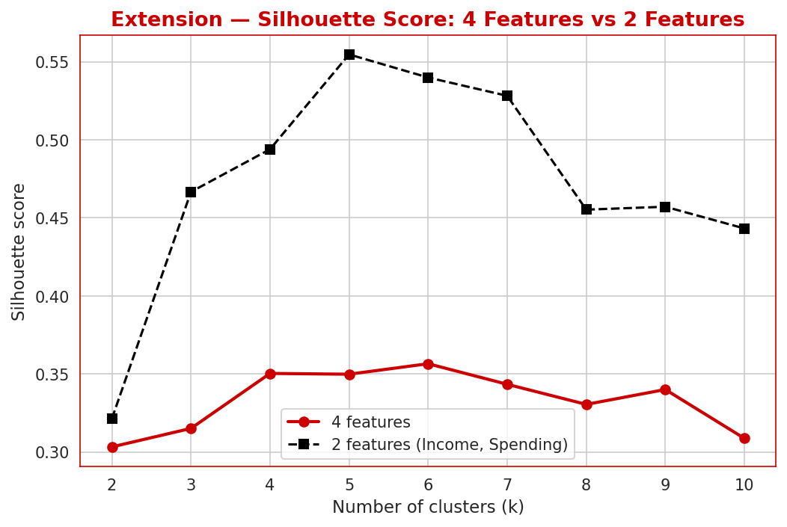 | Extension: 4 features vs 2 features |

## Tools used
Python 3 · Jupyter Notebook · pandas · NumPy · Matplotlib · Seaborn · scikit-learn · SciPy · Git/GitHub

## How to run
```bash
git clone <your-repo-url> && cd <repo>
pip install -r requirements.txt
jupyter notebook UL_PR1.ipynb      # Kernel > Restart & Run All
```

## Requirements
`pandas==3.0.2`, `numpy==2.4.4`, `matplotlib==3.10.8`, `seaborn==0.13.2`, `scikit-learn==1.8.0`, `scipy==1.17.1`

---
*Red & White Skill Education · Unsupervised Learning · PR 1*
