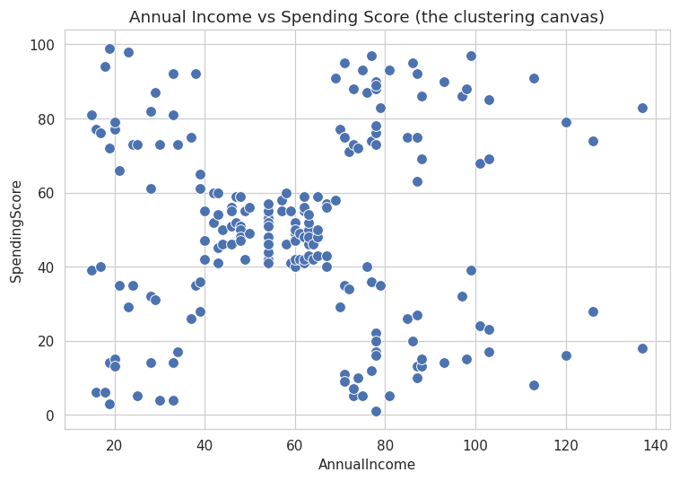
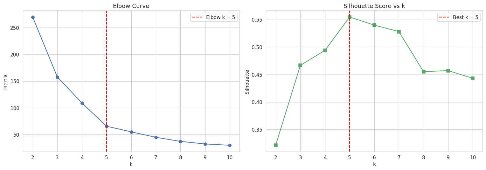
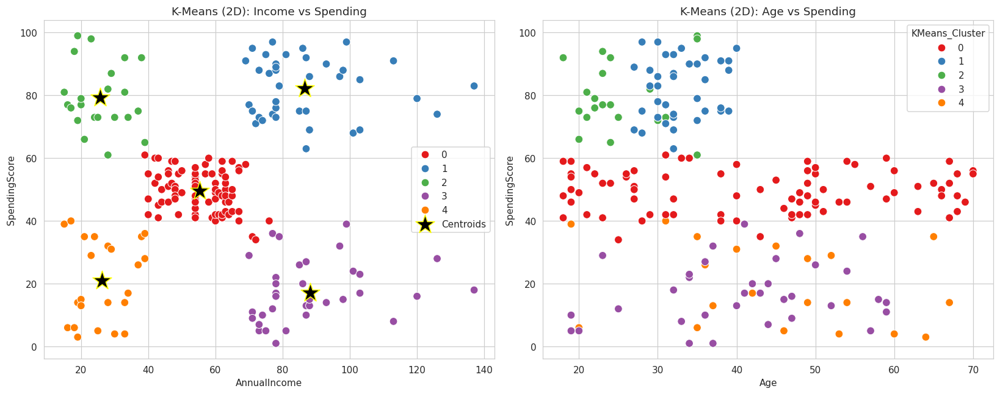
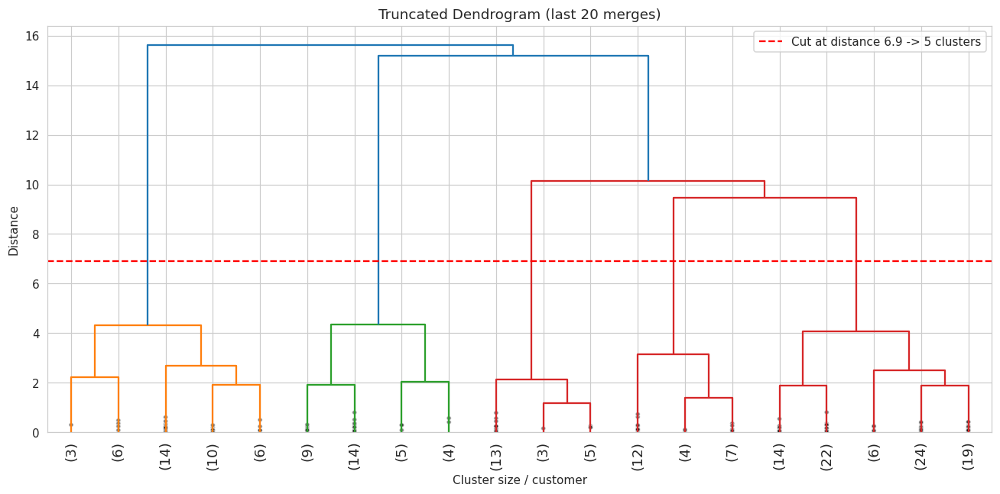
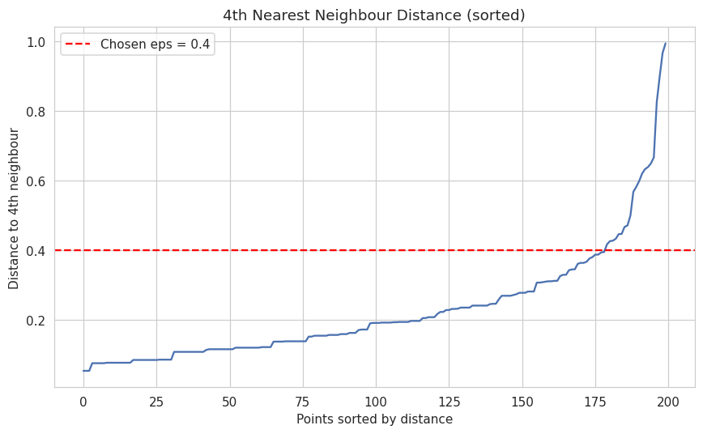
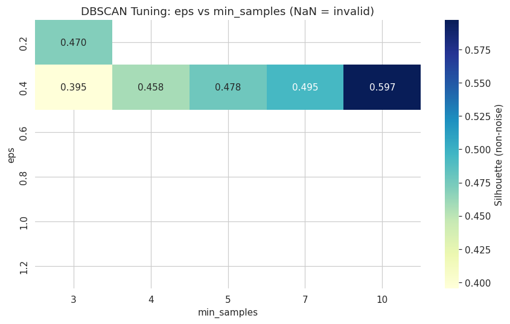
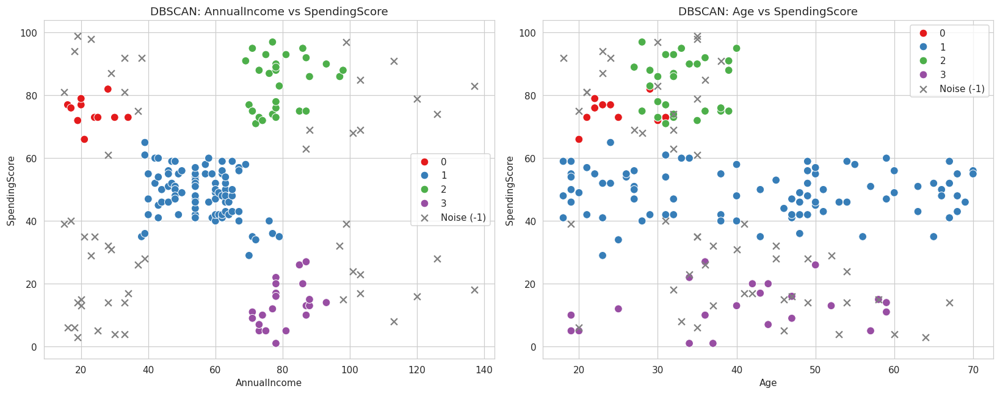

# 🛍️ Mall Shopper Segmentation — Unsupervised Learning

Segmenting 200 mall customers into retail personas using **K-Means**, **Agglomerative Hierarchical Clustering** and **DBSCAN**, then turning the segments into actionable retail strategies.

> **Practical Exam (Set B) — Unsupervised Learning** | Author: **Herit Tanna**

---

## 📌 Table of Contents
1. [Project Overview](#-project-overview)
2. [Dataset](#-dataset)
3. [Repository Structure](#-repository-structure)
4. [Setup & How to Run](#-setup--how-to-run)
5. [Methodology](#-methodology)
6. [Results](#-results)
7. [Shopper Personas](#-shopper-personas)
8. [Screenshots](#-screenshots)
9. [Using the Saved Model](#-using-the-saved-model)
10. [Video Walkthrough](#-video-walkthrough)

---

## 🎯 Project Overview
A mall chain (like Phoenix Marketcity or Nexus Malls) wants to understand visitor spending behaviour to redesign store layouts, plan promotional events and offer personalised loyalty rewards. This project finds natural shopper groups from income and spending data, compares three clustering algorithms, and recommends a strategy for every segment.

## 📂 Dataset
- **Name:** Mall Customer Segmentation Data
- **Source:** [Kaggle — Customer Segmentation Tutorial in Python](https://www.kaggle.com/datasets/vjchoudhary7/customer-segmentation-tutorial-in-python)
- **Size:** 200 rows × 5 columns — `CustomerID`, `Genre`, `Age`, `Annual Income (k$)`, `Spending Score (1-100)`
- **Quality:** no missing values; 112 female and 88 male customers

## 🗂️ Repository Structure
```
mall-shopper-segmentation-unsupervised-learning/
├── MallShopperSegmentation_UnsupervisedLearning.ipynb   # fully executed notebook
├── mall_scaler.pkl                  # saved StandardScaler
├── mall_segmentation_model.pkl      # saved final K-Means model
├── summary_report.md                # short report (algorithms + personas)
├── requirements.txt                 # dependencies
├── README.md
├── Mall_Customers.csv               # dataset
├── Mall_Customers_clustered.csv     # dataset + all cluster labels / personas
└── images/                          # plots used in this README
```

## ⚙️ Setup & How to Run
```bash
# 1. Clone the repository
git clone https://github.com/<your-username>/mall-shopper-segmentation-unsupervised-learning.git
cd mall-shopper-segmentation-unsupervised-learning

# 2. (Optional) create a virtual environment
python -m venv venv
venv\Scripts\activate          # Windows
source venv/bin/activate       # macOS / Linux

# 3. Install dependencies
pip install -r requirements.txt

# 4. Launch the notebook and run all cells (Kernel → Restart & Run All)
jupyter notebook MallShopperSegmentation_UnsupervisedLearning.ipynb
```
Keep `Mall_Customers.csv` in the same folder as the notebook.

## 🔬 Methodology
| Step | What was done |
|---|---|
| **1. EDA** | Distributions, boxplots, scatter plots, correlation heatmap, gender-wise summary |
| **2. Feature engineering** | Label-encoded Gender; created `IncomeGroup`, `AgeGroup`, `SpendingCategory`; scaled with `StandardScaler` |
| **3. K-Means** | Elbow + Silhouette for k = 2–10 → **k = 5**; compared 2D (Income, Spending) vs 4-feature set; PCA view |
| **4. Hierarchical** | Ward dendrogram with cut line; compared Ward / Complete / Average linkage |
| **5. DBSCAN** | k-NN distance plot for ε; grid search over 6 eps × 5 min_samples values |
| **6. Comparison** | Silhouette, Davies-Bouldin, Calinski-Harabasz; K-Means stability over 5 seeds |
| **7. Deployment** | Saved scaler + model with `joblib`; `classify_shopper()` function tested on 5 new shoppers |

## 📊 Results
| Algorithm | Clusters | Silhouette ↑ | Davies-Bouldin ↓ | Calinski-Harabasz ↑ | Noise |
|---|---|---|---|---|---|
| **K-Means** (k=5) ✅ final | 5 | 0.5547 | 0.5722 | 248.65 | 0% |
| Agglomerative (Ward) | 5 | 0.5538 | 0.5779 | 244.41 | 0% |
| DBSCAN (eps=0.4, min_samples=10) | 4 | 0.5972 | 0.4734 | 263.61 | 25.5% |

**Key findings**
- The 2D feature set (Income + Spending) gives much better clusters than adding Age and Gender (silhouette 0.555 vs 0.314).
- K-Means and Ward hierarchical clustering agree on **98%** of customers.
- K-Means is perfectly stable across 5 random seeds (silhouette std ≈ 0).
- DBSCAN has the best raw scores but labels **25.5%** of shoppers as noise, so **K-Means** was chosen as the final model: it covers every customer and can score new ones.

## 👥 Shopper Personas
| Persona | Profile | Retail strategy |
|---|---|---|
| 💎 **Big Spenders** (39) | High income (~86k), high spending (~82), age ~33 | Premium lounge and luxury pop-ups near the food court; early-access loyalty tier |
| 🌟 **Young Aspirers** (22) | Low income (~26k), high spending (~79), age ~25 | Social-media events, student nights, app cashback and instalment offers |
| 🛒 **Mainstream Shoppers** (81) | Average income (~55k) and spending (~50), age ~43 | Family bundles, weekend combos, points on every bill |
| 🏷️ **Budget Shoppers** (23) | Low income (~26k), low spending (~21), age ~45 | Value stores near entrances; ₹50-off coupons and BOGO alerts in the mall app |
| 🧐 **Careful Spenders** (35) | High income (~88k), low spending (~17), age ~41 | Premium dining, electronics / home expos, concierge service to convert income into spending |

## 🖼️ Screenshots
**Income vs Spending — the clustering canvas**



**K-Means: Elbow & Silhouette**



**K-Means clusters with centroids**



**Ward dendrogram with cut line**



**DBSCAN: k-NN distance plot and tuning heatmap**




**DBSCAN clusters (noise shown as grey ×)**



## 🚀 Using the Saved Model
```python
import joblib
import pandas as pd

scaler = joblib.load('mall_scaler.pkl')
model = joblib.load('mall_segmentation_model.pkl')

# Annual income and spending score of a new shopper (income in thousands, like the dataset)
new = pd.DataFrame([[30, 85]], columns=['AnnualIncome', 'SpendingScore'])
print(model.predict(scaler.transform(new)))   # -> cluster id (see the persona mapping in the notebook)
```
The notebook also contains `classify_shopper(age, annual_income, spending_score, gender=None)`, which returns the cluster label and persona name directly. Example: a 22-year-old female with income 30 and spending score 85 → **Young Aspirers**.

## 🎥 Video Walkthrough
▶️ **Watch the video:** [PASTE YOUR GOOGLE DRIVE / YOUTUBE (UNLISTED) LINK HERE](https://)

## 🛠️ Tech Stack
Python • pandas • NumPy • Matplotlib • Seaborn • scikit-learn • SciPy • joblib • Jupyter

## 👤 Author
**Herit Tanna** — Entry-level Data Analyst, Rajkot, Gujarat
